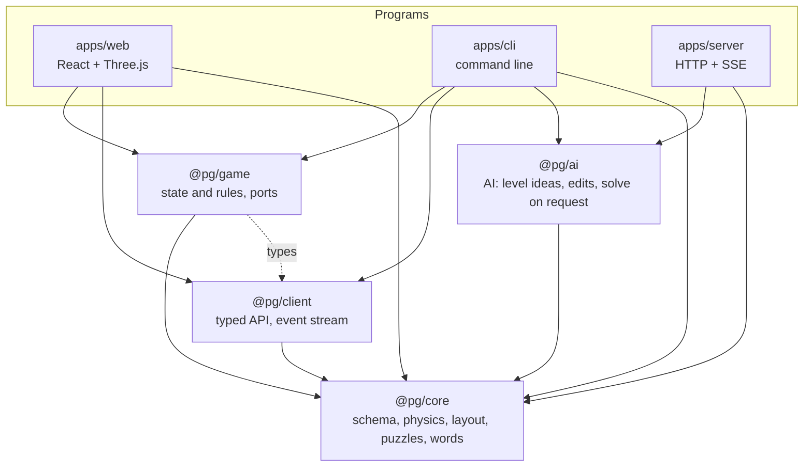
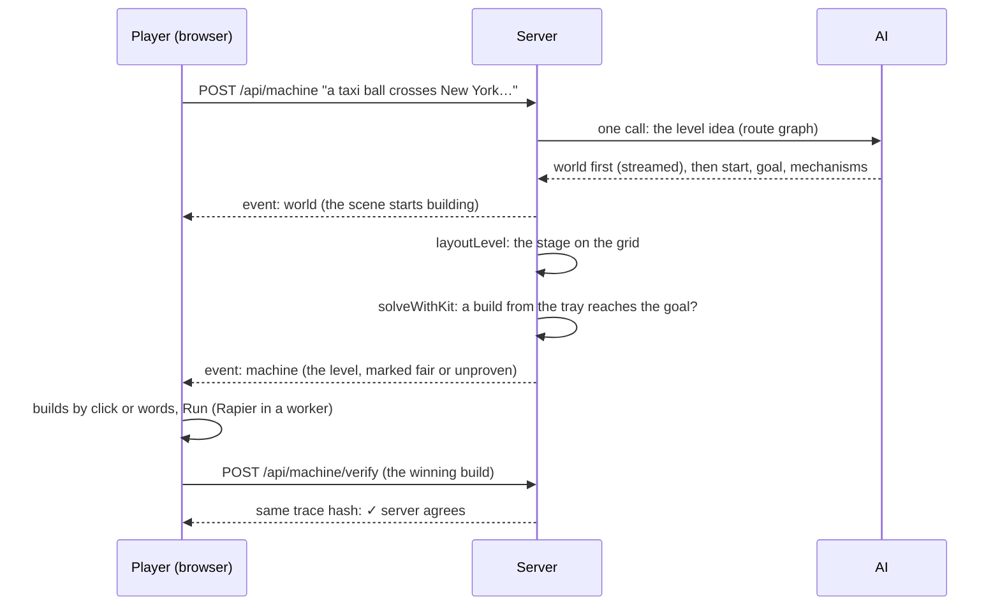

# Architecture

Prompt Goldberg turns one plain-language sentence into a 3D level with real physics, then lets the player change it and build in words. The game is one user of a layered engine; the command line (`apps/cli`) is a second one, built from the same packages.

## Layers



Arrows point at what a layer depends on. The rule: **lower layers never import upper ones**, and only `apps/*` touch a framework (React, Fastify) or a platform (DOM, `localStorage`, Node workers).

| Layer | Package | What it is | What it never does |
| --- | --- | --- | --- |
| Core | `packages/core` (`@pg/core`) | The level schema (zod), the parts kit and its colliders, Rapier physics, ordered goals, the stage layout (`layoutLevel`), puzzles, worlds and landmarks, and the word parsers (`words/`: "add a fan next to the ball", "build a fence around the tomb") | Call an AI, the network or the DOM |
| AI | `packages/ai` (`@pg/ai`) | Prompts and AI backends (any provider in the registry; the server's own is Claude, by API or local CLI), the level-idea writer (route graph), edits, solve on request, the physics worker pool | Render, hold game state, serve HTTP |
| Networking | `packages/client` (`@pg/client`) | Typed calls for every endpoint and the server-sent event reader; `fetch` and base URL injectable, so it runs in a browser, Node or a test | Keep state, know about React |
| Game | `packages/game` (`@pg/game`) | The workshop's state machine (create, play, build by words, change the level, run, stars, daily) on a vanilla store; the server, physics runner, sound, storage and clock come in as **ports** | Touch the DOM, fetch, or a framework |
| Programs | `apps/web`, `apps/server`, `apps/cli` | Wiring and presentation: the web app in `app/` (wiring), `ui/` (panels), `scene/` (3D), `platform/` (worker, audio); the server's routes, limits and storage; the CLI's commands | Hold rules that another program would need |

## One sentence, end to end



1. **Idea.** `@pg/ai` asks the AI for a small route graph: the world (palette, features, a landmark composed from shapes or a ready-made one, obstacles), where the ball starts, the goal, and the mechanisms an answer might use. It is streamed: the world arrives first (`world` event) so the scene builds up while the rest is laid out. One AI call per level.
2. **Stage.** `layoutLevel` in `@pg/core` turns the idea into a level with no AI: start shelf or hill, a goal far across the board, river or pit, the named things and the world's obstacles in the way, a clear floor path kept. One physics run with nothing placed makes sure the level does not solve itself.
3. **Fairness proof.** `solveWithKit` (beam search over placements along the ball's path, simulated in the physics worker pool) looks for a build from the player's own tray that reaches the goal. Found: the level is fair. Not found in time: it is still played, marked unproven. The solution is never shown; it only proves one exists.
4. **Play.** `@pg/game` opens it as a puzzle: the tray is the player's. The player builds by clicking or by words (`readBuildMove`), the designer changes the level by words (`looksFromWords` for looks, `readSceneMove` for scenery, the AI for anything else), and Run plays it whenever they like. Physics runs in a browser worker; a winning build is re-run on the server and the trace hashes must match.
5. **Solve on request.** Only when the player asks, `@pg/ai` looks for a way through by adding parts, never moving the level's own; the physics checks it and nudges only the added parts. An honest miss when it finds none, and no stars.

## AI providers, the Workbench and 3D looks

- **Providers** (`packages/ai/src/providers`): a registry of text providers (Claude, OpenAI, any OpenAI-compatible endpoint) and mesh providers (Tripo, Meshy). The server uses its own Claude unless a request carries a player's provider and key in headers; those are used for that request only and never stored. Adding one is one file plus one line ([README](packages/ai/src/providers/README.md)).
- **Workbench** (`packages/ai/src/machine/gadget.ts`): a part from a description, built from a few boxes, cylinders and spheres; its boxes collide, so it works in the physics. Every part made goes into a shared library (`apps/server/src/parts.ts`, `DATA_DIR/workbench-parts.json`); asking again by its name or words returns the kept part with no AI call.
- **3D looks**: a mesh provider makes a model for a Workbench part; the server downloads it from the provider's own hosts only, shrinks its textures to 512 px (`apps/server/src/shrinkMesh.ts`), keeps it under its hash and attaches it to the part. The part's shapes stay its colliders; the model is only what is drawn.
- **The library**: 503 things (animals, vehicles, buildings, food, landmarks), each a shape recipe composed once by the AI and reviewed on the `#recipes` page; 108 have Tripo models made once with `scripts/pregen-library.ts`.

## Failsafes

- A change to a level is applied only after the AI's answer passes every check (schema, the level's own rules); otherwise the level stays exactly as it was.
- A change is a few small edit operations on a fast model, tried up to three times on an invalid answer (the full rewrite only with `EDIT_OPS=off`: it takes about 60 s on a big level); the whole change stops at `EDIT_DEADLINE_MS` (25 s).
- Plain messages for the player ("Nothing changed: try again"), details in the server log.
- The commonest requests never reach the AI: looks, placing, turning and removing parts, adding named scenery.
- Spending: a daily AI-call cap kept on the data volume (so a redeploy does not reset it), per-IP rate limits, and a player's own key outside the cap.

## Ports (how the game stays reusable)

```ts
const game = createGame({
  api,        // the server: AI streams, puzzles, verification, daily, gallery
  physics,    // run a machine and return its playback trace
  sound,      // optional
  stage,      // optional: the stage size for new levels
  storage,    // optional: saved stars, best daily, player name
  now,        // optional: the clock, for pop-in timing
});
```

The browser passes a Web Worker, `localStorage` and `@pg/client` (`apps/web/src/app/game.ts`, 37 lines). The CLI and the tests pass `inProcessPhysics()` and `noServer()` from `@pg/game` and run whole games in Node.

## Reuse beyond this game

The engine underneath is "language in, a structured physical scene out, then changed by more language". The same packages can, for example:

- generate physics lessons or exercises as JSON from a teacher's sentence (`pg level "..." --out lesson.json`);
- feed another renderer or engine: a level is plain, validated data (`MachineSpec`);
- run batch evaluation of prompts headless (`apps/cli`, `packages/ai/scripts/eval-machine.ts`);
- put a different front end (mobile, VR) on `@pg/client` and `@pg/game` without touching the rules.

## Tests

Each layer is tested on its own: core (physics, layout, puzzles, words), AI (pipelines with a fake model), client (stream parsing, errors), game (a whole game headless), server (routes with inline physics), web (the store wiring, settings) and the CLI. `npm test` runs all of them; `npm run typecheck` checks every project reference.
