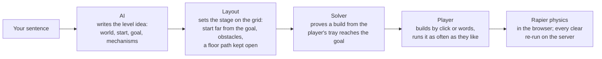

# Prompt Goldberg

**One sentence makes a level. Someone else solves it.**

Type any idea, in any language: *"a taxi ball crosses New York and stops at the Statue of Liberty"*. In seconds the AI turns it into a 3D physics level: the world, where the ball starts, the goal, a landmark that belongs there and the obstacles in the way. Then a person solves it, placing ramps, fans and cannons by clicking or by saying where they go, and pressing Run. The AI sets the stage; it never plays the game for you.

Made for the **Victoria VR AI Builder Hackathon 2026**.

| | |
|---|---|
| **Play it** | https://ogserver-production.up.railway.app (no sign-up) |
| **Docs, architecture and API on one page** | https://ogserver-production.up.railway.app/docs |
| **Tribute to Rube Goldberg** | https://ogserver-production.up.railway.app/rube |
| **Demo video** | 1:56, in the submission ([storyboard](DEMO.md)) |
| **Code** | this repository, MIT licence |

## Try it in a minute

1. **Start with level 1.** One ramp in your tray, twelve dominoes and a bell: find where the ramp goes (click the stage, or say it in the Build box, e.g. `put a ramp next to the ball`) and press Run. The levels give no hints: they are yours to crack.
2. **Make a level.** Back on the start screen (🎮 Levels), type anything: a place, a story, three emoji, a sentence in Slovak. About five to ten seconds later the level is there. You are its designer: say `build a fence around the goal`, `make it night`, or make a brand-new part on the Workbench (`a spiral chute`).
3. **Test it as a player**, then **Send to a player**: the whole level travels in the link.

Stuck for ideas? 💡 **Prompt ideas** (top left) shows twelve levels the AI made, with the sentence that made each; open any of them at once, or ask for your own version.

## Why it matters

Making a game level has always meant learning a level editor. Here the editor is a sentence, and the game is still a game: the AI is the level designer, a person is the player. That split is the point. Every level is a small physics puzzle that the AI proves can be solved with the player's parts, but it never solves it for them unless asked, and then without stars.

- **For players**: endless puzzles in worlds they ask for, from the Eiffel Tower to a messy kid's bedroom.
- **For creators**: a level in a sentence, refined in more sentences, shared as a link. New parts come from the Workbench, with a 3D model: a few free ones a day on the server, or any number on their own 3D model key.
- **For education**: every level is cause and effect you can see; it runs on real rigid-body physics.
- **For VR and the metaverse**: a level is plain, validated JSON (`MachineSpec`), so another front end (a VR world, a mobile app) can play the same levels through `@pg/client` and `@pg/game`.

## Any sentence

The game is tested against a fixed set of 50 prompts written to break it ([`apps/cli/judge-prompts.json`](apps/cli/judge-prompts.json)): real places, fiction, everyday rooms, one-word prompts, long stories, typos and capitals, Slovak, German and Spanish, emoji, impossible requests ("the ball must go upwards forever"), no ball at all, a prompt injection.

| Group | Prompts | Fair levels |
|---|---|---|
| Real places (Tatras, New York, Paris, Giza, Venice, Tokyo, Sahara, London, the Moon, British Columbia) | 10 | 10 |
| Fiction (dragon, pirates, wizard, space, dinosaurs, Atlantis, candyland, haunted mansion) | 8 | 8 |
| Everyday (workshop, breakfast, kid's room, office, kitchen, garden, golf, bowling) | 8 | 8 |
| Vague ("fun", "bounce", "make it hard", a mood, emoji) | 6 | 6 |
| Long stories | 4 | 4 |
| Messy (typos, caps, Slovak, German, Spanish) | 5 | 5 |
| Odd (impossible, no ball, huge, tiny, Victoria VR metaverse, prompt injection, a list of nouns, music, seasons) | 9 | 8 |
| **All** | **50** | **49** |

*Fair* means proven when the level was made: a build from the player's own tray reaches the goal in the physics. The one miss ("a huge machine across the whole map") is reported honestly as unproven. Full results: [RESULTS.md](RESULTS.md).

What makes it general rather than a set of templates:

- **No hard-coded worlds.** The AI writes the world (palette, features, obstacles, a landmark) for whatever the sentence names; keyword worlds exist only as an offline fallback.
- **A library of 503 things** (animals, vehicles, buildings, food, about sixty world landmarks), each a shape recipe composed once by the AI and reviewed, found by words with no AI call; **108 of them have 3D models**, from the Eiffel Tower and Burj Khalifa to a toy box and a giant clam.
- **New parts on demand.** The Workbench builds a part from a description ("a zigzag slide", "a spinning paddle wheel"); its boxes collide and its spinning shapes push the ball, so it works in the physics. Every part made is kept in a shared library and reused without another AI call.
- **Bring your own AI.** Settings → AI providers: Claude, ChatGPT, any OpenAI-compatible service (OpenRouter, Groq, a local Ollama), Tripo or Meshy. Keys stay in the browser and are used for that request only. A new provider is one file ([`packages/ai/src/providers`](packages/ai/src/providers/README.md)).
- **Words for everything the player does.** `add a fan 3 cells east of the ball`, `turn the fan to face south`, `put the spiral chute next to the taxi`, `remove` + a click, `make it night`: read by plain parsers, instantly, with no AI call.

## How it works



1. **One AI call per level.** The AI answers with a small *route graph* (the level idea), streamed so the world appears while the rest is laid out. Median 5.6 s on the live server (six judge prompts, 2026-11-03).
2. **Layout without AI.** `layoutLevel` places the start, the goal across the board, the named things in the way and the world's obstacles, keeping a floor path open, and makes sure the level does not solve itself.
3. **Fairness proof.** A beam-search solver tries builds from the player's own tray in the physics; the level is marked fair only when one reaches the goal.
4. **Play.** The physics (Rapier, deterministic) runs in a browser worker. When the player wins, the server runs the same build and compares the trace hash: *✓ server agrees*.
5. **Fails safe.** A change to a level is applied only after the AI's answer passes every check; a bad answer is retried, a slow one stops at 25 s, and the level is left exactly as it was with a plain message. Looks ("make it night", "snowy"), parts and removals never call the AI at all.

Details, layers and ports: [ARCHITECTURE.md](ARCHITECTURE.md).

## Run it locally

Node.js 24 and npm.

```sh
npm ci
cp .env.example .env    # LLM_BACKEND=cli uses your local Claude Code login; production uses ANTHROPIC_API_KEY
npm run dev:server      # API on :8787
npm run dev             # the game on http://localhost:5173
npm test                # 168 tests across every layer
```

The same engine on the command line, and the judge set:

```sh
npm run pg -- level "a snowball races down the High Tatras into a mountain hut" --out tatras.json
npm run pg -- play tatras.json "put a ramp under the snowball" "add a fan 4 cells east of the snowball"
npm run pg -- judge --server https://ogserver-production.up.railway.app --only tokyo,slovak,emoji
```

Deploying: [DEPLOY.md](DEPLOY.md) (Railway, one Docker service, a volume for `/data`).

## Repository

| Path | What it is |
|---|---|
| `packages/core` | Level schema, parts kit and colliders, Rapier physics, goals, layout, the fairness solver, worlds and the 503-thing library, word parsers |
| `packages/ai` | Prompts and AI backends, the level idea, edits, the Workbench, AI providers, physics worker pool |
| `packages/client` | Typed API and event-stream client for any JavaScript runtime |
| `packages/game` | The game's state and rules, with ports for server, physics, sound and storage |
| `apps/web` | React + Three.js game |
| `apps/server` | Fastify API: streaming AI, verification, daily puzzle, community levels, rate limits, storage |
| `apps/cli` | `pg level / play / solve / judge`: the same engine without a browser |

## Honest limits

- One ball per level; a run simulates 15 seconds by default (30 at most).
- A themed thing is a themed part: a pizza is a named ball, an oven a named bucket. The physics is the kit's.
- "Fair" proves one build works with the tray; it does not prove a level is fun or easy. "Solve it for me" says so when the AI finds no way.
- Most world things are shape recipes; 108 have 3D models. The rest are drawn from simple shapes.
- ChatGPT and Meshy support is marked experimental: built and unit-tested, not run end to end.

## Credits

The game's own AI runs on Claude (Anthropic); players can bring another. 3D models by Tripo. Narration in the demo video by ElevenLabs. Physics by Rapier. Full list: [CREDITS.md](CREDITS.md). The earlier Orbital Goldberg prototype is on the `archive/orbital` branch.
