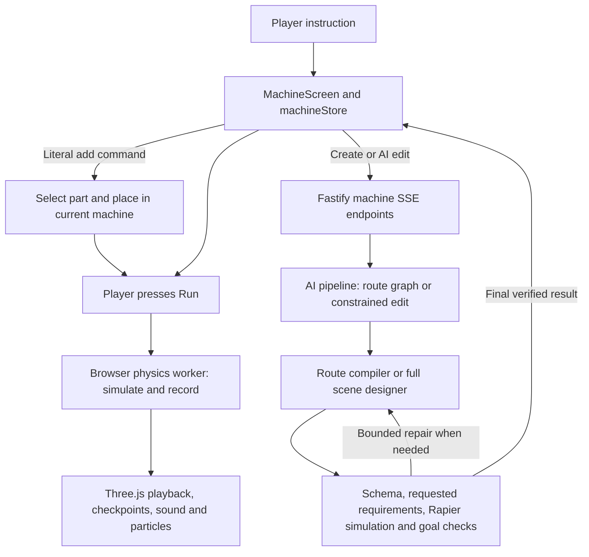

# Prompt Goldberg: reference review and visual brief

Reviewed 2026-10-28 against the current working tree, including its existing uncommitted changes.

Update, 2026-10-29: the audit below records the earlier baseline. The user subsequently enabled Tripo; optional custom part appearances are now implemented and locally tested. See [TRIPO.md](TRIPO.md) for the current scope and evidence. The reference's additional mechanics and full scenic redesign remain outstanding.

The reference makes sense as an art direction and a guide to reliable generation. Its scope needs adapting to the product already built: a browser workshop where plain language creates or changes a working marble machine, and the player can place parts, run it, and understand the result. The first experience must explain that promise.

The reference is [Skybound Chaos](VictoriaVR_Goldberg_Hackathon_Reference_FIXED/goldberg_hackathon_reference/README.md), including its [concept image](VictoriaVR_Goldberg_Hackathon_Reference_FIXED/goldberg_hackathon_reference/assets/contraption_reference.png). The ZIP contains the same README and image; it contains no reusable 3D models. Application source was not changed for this review.

## What to keep and adjust

| Reference idea | Application to Prompt Goldberg |
| --- | --- |
| Miniature wooden amusement park, stone foundations, dark metal, red accents, brass | Adopt as the visual direction. Current procedural geometry provides a starting point, but the image's asset detail and composition still require work. |
| Prompt → plan → layout → validation → presentation | Already substantially present. Extend the current pipeline and scene format. |
| Understandable cause and effect | Essential. Make the start, active mechanism, next checkpoint, and finish visible in the scene. |
| Rich scenery around a small number of mechanisms | Good fit. Supports, planks, rocks, trees, flags and water can be reusable visual components. Keep them outside the action and placement areas. |
| Unity prefabs, C# services and engine migration | Translate these concepts into the existing TypeScript, React Three Fiber, Three.js and Rapier implementation. No engine change is justified. |
| Airplane, looping coaster, hanging bucket and pulley | New mechanics. A model alone does not provide launch, flight, capture, trigger, reset or goal behavior. These require separate contracts and tests. |
| Scripted domino propagation and spline-controlled mechanisms | A possible future extension. The current simulation uses physical dominoes and a hinged seesaw, with authored fan/cannon/trampoline behavior. Preserve what works; any guided mechanism must still react to actual inputs and be described honestly. |
| Seven to ten beats, three terraces, 15–25 seconds | Too much for the first interaction and beyond the current route graph. Begin with a few readable actions. The graph supports 1–3 links; scene goals are capped at four. Explicit requests above 14 seconds are currently rejected, despite a wider duration range in the raw schema. |
| Known-good fallback | Keep examples available and clearly identified. Failed edits must preserve the current machine. Never silently substitute a solved example for an edit. |

The opening tutorial currently teaches placement well, but it does not yet teach the main AI promise. “Add a fan” is deliberately a local placement command. It is useful interaction, but it is insufficient evidence of AI planning a functioning machine. New-machine creation is also visually secondary in the current UI.

## As-built architecture

Actual entry points and formats:

- [MachineScreen.tsx](../apps/web/src/machine/MachineScreen.tsx), [machineStore.ts](../apps/web/src/machine/machineStore.ts), and [commands.ts](../apps/web/src/machine/commands.ts): prompt modes, literal placement, transactional AI updates, tutorial and Run controls.
- [app.ts](../apps/server/src/app.ts): `/api/machine` and `/api/machine/edit`, both requesting verification; SSE progress and error handling.
- [route.ts](../packages/ai/src/machine/route.ts), [pipeline.ts](../packages/ai/src/machine/pipeline.ts), and [intent.ts](../packages/ai/src/machine/intent.ts): constrained AI requests, bounded repair, explicit supported requirements, and labeled keyword-based construction when AI is unavailable.
- [compile.ts](../packages/machine/src/compile.ts): `RouteGraph`, seeded layout trials and strict compilation. This is a small linear route representation, not the reference's general typed-port event graph.
- [schema.ts](../packages/machine/src/schema.ts), [kit.ts](../packages/machine/src/kit.ts), [sim.ts](../packages/machine/src/sim.ts), and [goal.ts](../packages/machine/src/goal.ts): bounded `MachineSpec`, 11 part kinds, colliders, physics events and ordered goal evaluation.
- [machine.worker.ts](../apps/web/src/machine/machine.worker.ts) and [MachineScene.tsx](../apps/web/src/machine/MachineScene.tsx): local simulation, recorded transforms, perspective camera, procedural meshes, lighting and event feedback.

## Evidence and capability matrix

Baseline environment: Windows/PowerShell, Node v24.14.0, npm 11.9.0, branch `main`, base commit `66aa332`, plus the existing working-tree changes. No dependencies were installed.

| Capability | Status | Evidence and limits |
| --- | --- | --- |
| Browser workshop and interaction | VERIFIED WORKING locally | Fresh Chrome walkthrough: place fan, Run, Undo, R/Escape, tutorial ramp, then fan on the same machine. Mobile layout checked at 390×844. |
| Language → geometry and working logic | VERIFIED WORKING for three sampled requests | Fresh live API requests produced fan → bell, cannon → bucket, and ramp → dominoes → bell. Saved results independently simulated successfully. This is not a broad prompt-success benchmark. |
| AI planning | VERIFIED WORKING for sampled requests | Live configured API and route-generation path. Literal add commands intentionally do not call the model. |
| Component catalog and placement | VERIFIED WORKING for existing kit | Schema/kit, compiler and placement tests, plus browser pointer placement. No airplane, coaster, pulley or custom mesh type exists. |
| General event-port graph | PARTIAL | Linear route graph and ordered goals exist; arbitrary typed-port wiring does not. |
| Physics and event recording | VERIFIED WORKING for tested cases | Full tests, browser run, independent simulation of all three new generated specs. |
| Replay reproducibility | VERIFIED WORKING for saved tested scenes | Repeated simulations of each new saved scene had matching trace hashes; determinism tests also pass. Re-entering the same prompt does not guarantee the same generated plan. |
| Complete generation provenance | PARTIAL | Specs, traces and local audit artifacts exist. The reference's unified persisted prompt/model/seed/catalog/trace record is not established. |
| Play, pause, replay and camera | PARTIAL relative to reference | Existing controls and playback implementation; explicit Run and completion rechecked in browser. Automatic slowdown near goals exists; a user-selected slow-motion control does not. |
| Reference visual style | PARTIAL | Lighting, simple part decoration, confetti and terrain exist. Current screenshot has a large sparse grid, small mechanisms and visually unsupported elevated pieces. No GLB/GLTF/FBX/Blender asset files found outside dependencies. |
| Airplane/coaster/pulley chain | MISSING | Not in the part schema, renderer or behavior catalog. |
| Failure preservation and verification | VERIFIED WORKING in covered cases | Store/API/AI regressions pass. Final results are checked before replacing the scene. Broader arbitrary-prompt resilience remains unmeasured. |
| Public deployment and judging uptime | UNKNOWN | Local production build and API health work. A public demo URL and judging-period monitoring were not verified. |
| Submission package | PARTIAL | README, credits, deployment instructions and presentation notes exist. Public repo availability, final video and submission/category confirmation were not verified. |

Commands and results on this review:

- `npm test`: 203 passed across 27 files.
- `npm run typecheck`: passed.
- `npm run build`: passed; existing large-chunk warning remains. Main JS is about 1.43 MB before compression; physics worker about 4.44 MB. These are bundle sizes, not download timings or measured frame rates.
- `node data/workshop-check/simple-flow-check.mjs`: passed. “Add a fan” caused no machine creation/edit API call and retained the current build.
- Three fresh `/api/machine` requests: all returned solved scenes, passed independent simulation and reproduced the same trace on a second run. Observed request-plus-local-check times were 2.926 s, 2.131 s and 2.357 s.

Local artifacts, excluded from Git: `data/workshop-check/reference-audit-{tests,typecheck,build}.log`, `reference-audit-live.json`, and screenshots `13-simple-welcome.png` through `17-simple-mobile.png`. The walkthrough harness records screenshots, not a continuous video. Real-device Safari and public hosting were not tested.

## Intended player and judge experience

The product promise should be visible immediately: **Describe a chain reaction. Build it in 3D. Run it. Change it.**

1. Offer one short editable example: “Fire a marble from a cannon over a river into a bucket.” Clearly label any starting scene as an example.
2. Show the proposed sequence in plain language while building: ramp → cannon → bucket. Keep technical evidence available on demand.
3. Leave the result ready for the player to press Run. Highlight the mechanism currently acting, using recorded events rather than a decorative animation unrelated to the simulation.
4. Explain the result briefly: “The cannon cleared the river; the marble landed in the bucket.” On failure, point to the first missed checkpoint.
5. Invite one change. Preserve literal “add a fan” → place it → Run. Also offer a supported functional AI change, such as a different required mechanism or bell count, once that exact example is verified.

An unassisted tester should be able to identify the goal, explain what their words changed, and run the machine without knowing the architecture. This still needs a human playtest; code and browser checks cannot establish comprehension.

## Smallest useful implementation sequence

| Priority | Change | Effort / risk | Acceptance and rollback |
| --- | --- | --- | --- |
| 1 | Make prompt-driven behavior clear in the first visit; connect numbered scene markers to actual events | Medium; low-to-medium UI risk. Uses existing goals and traces. | A fresh tester describes the product and completes create → Run → change. Add-fan preservation remains covered. Isolate onboarding/event-overlay changes so the current flow can be restored. |
| 2 | Restyle one verified scene with wooden ramps/platforms, metal supports, a brass goal, stone base, restrained scenery and closer framing | Medium; camera, occlusion and rendering risk. Depends on the current kit dimensions. | Compare desktop/mobile captures; preserve collision surfaces, placement and trace hashes. Profile on the intended laptop before expanding the art. Keep the previous renderer as a rollback point while developing the theme. |
| 3 | Package three distinct examples and test the actual hosted build, recovery and replay | Medium; requires hosting access/URL and API availability. | Public fresh-browser create → Run → change → replay, plus unavailable-model test and a short recorded demo. Preserve a known-good deployment artifact. |

Airplane/coaster mechanics follow these steps only if they materially improve the experience and there is time to validate them. A dramatic existing cannon can provide the first spectacle.

## What is needed for the 3D scene

Nothing additional from the user is required to begin the first visual pass. Existing Three.js tooling can create an original modular kit procedurally. Tripo remains deferred. Matching the reference's general style is feasible; matching all its detail is an asset and composition task whose quality needs visual review.

| Asset group | Initial contents | Purpose |
| --- | --- | --- |
| Working mechanism visuals | Ramp, platform, fan, cannon, seesaw, trampoline, domino, bucket, bell, wall and marble | Recognizable silhouettes over the existing tested behaviors. |
| Construction pieces | Planks, posts, cross-braces, brackets, bolts and stone foundation blocks | Make elevated mechanisms look built and supported. |
| Scenery | A few rocks, pine trees, flags, a bridge treatment and stylized water | Establish the miniature amusement-park setting without hiding or obstructing the route. |
| Shared materials | Warm wood, dark metal, brass, red painted accents, stone and water | Keep all assets in one coherent visual style. |
| Presentation | Camera framing, readable shadows, start/goal markers, active-step highlight and finale effects | Let players and judges follow the machine without narration. |

If externally authored models are supplied, the preferred handoff is individual `.glb` files with embedded materials, consistent scale and named separate moving pieces. Match the existing kit: Y up, zero-yaw forward +X, 0.5 m grid cells, and each part's dimensions/origin from `kit.ts`. Pivots must sit on actual rotation axes. Visuals should fit the existing colliders; visible rails or surfaces that appear functional must agree with simulation behavior. Include editable source and provenance/license information where available. Public-repository redistribution rights need checking for any third-party asset pack.

For later plane/coaster work, a model additionally needs a behavior design: activation input, motion path, collision/trigger regions, output event, failure conditions and complete reset. Asset generation does not supply those contracts.

The user can optionally provide existing models and the intended judging device/browser. Neither blocks a procedural first pass. A public demo URL or hosting access will be needed for the deployment audit.

## Competition-reference correction

The official briefing confirms the central requirement of browser-based language-to-3D creation with working logic and meaningful AI involvement. The existing stack fits that requirement. See the [organizer briefing](https://www.victoriavr.com/news/ai-builder-hackathon-2026-the-building-period-2042daf3) and [terms, section 6](https://www.victoriavr.com/hackathon/2026/terms).

The supplied reference writes **November 11 at 16:30 CET**. Both official pages currently write **16:30 CEST**, and the terms explicitly specify UTC+2. That is a one-hour difference. Treat the document's CET time as unconfirmed and check the submission portal; plan to submit earlier than either interpretation. No organizer contact was made. The other ambitious success-rate and composition figures in the reference are targets, not measured project results.
