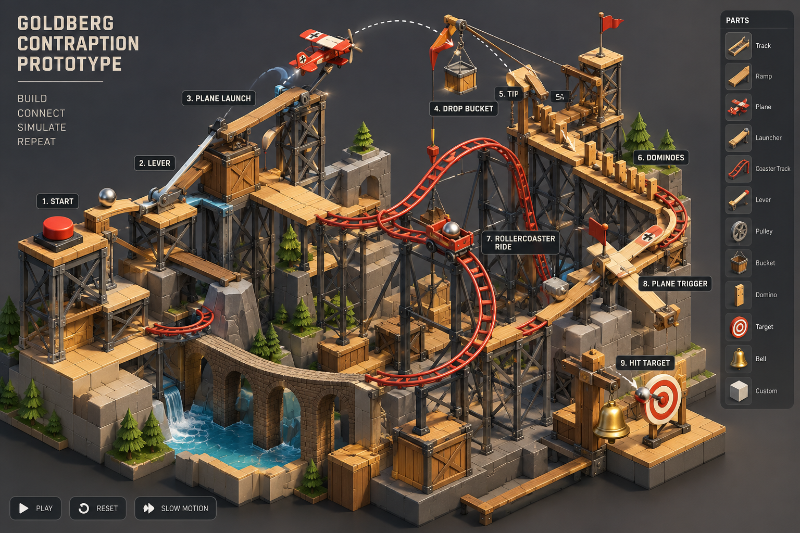

# Skybound Chaos — Prompt-to-Contraption Hackathon Reference

> **Goal:** Turn one natural-language prompt into a visually rich, isometric, interactive Rube Goldberg machine that runs reliably throughout judging week.



**Image status:** Concept art / visual reference, **not** a screenshot of a working simulation. Its labels and geometry are illustrative; the generated machine must be assembled from real components and validated independently.

## 0. FIRST: audit the existing system before designing or changing anything

> **This project already has an implementation.** The material below is a reference and a set of candidate improvements, **not** a specification to rebuild it from scratch. No repository, executable, or implementation evidence was supplied with this document, so all implementation statuses are **UNKNOWN** until verified.

### Agent instructions — mandatory discovery pass

1. **Inspect before editing:** inventory the repository, README/docs, project files, branches, build scripts, dependencies, assets, scenes, tests, deployment configuration, and recent commits. Identify the actual engine/framework rather than assuming Unity.
2. **Run the existing system:** follow its documented setup, build and test commands. Record environment, versions, command output, errors, and screenshots/video where possible. Do not claim success from reading code alone.
3. **Trace the actual pipeline:** determine what happens from prompt input through planning, asset selection, placement, simulation, rendering, validation, and replay. Draw an *as-built* architecture with source-file references.
4. **Audit each capability:** label it `VERIFIED WORKING`, `IMPLEMENTED UNVERIFIED`, `PARTIAL`, `MISSING`, `BROKEN`, or `UNKNOWN`. Cite paths, symbols, tests, logs or observed behavior for every non-UNKNOWN assessment.
5. **Preserve working parts:** distinguish existing features from proposed changes; reuse current APIs, scene formats, assets, and conventions. Do not replace frameworks, restructure the project, or add dependencies without a justified gap and explicit approval.
6. **Prioritize gaps:** compare the existing implementation with the desired hackathon demo and visual reference. Rank gaps by judging impact, risk, effort, and dependencies. Propose a minimal incremental plan with rollback points.
7. **Ask only blocking questions:** if access, run instructions, or essential requirements are missing, list what you need; do not fabricate an audit or silently start building a parallel system.
8. **Only after the audit:** request approval of the proposed scope, then implement the highest-impact missing feature, test it, and update the matrix.

### Capability audit matrix — initial state

| Capability | Current status | Evidence to collect | Desired outcome |
|---|---|---|---|
| Prompt input and interpretation | UNKNOWN | UI/API route, example requests | Converts requests to constrained intent |
| Planner / causal graph | UNKNOWN | Plan models, sample outputs | Connected typed event graph |
| Component / asset catalog | UNKNOWN | Registry, prefabs/assets, ports | Reusable airplane/coaster/etc. |
| Spatial layout and connections | UNKNOWN | Placement code, generated scenes | Legible multi-tier layout |
| Physics and activation events | UNKNOWN | Runtime code, event traces | Working causal chain |
| Roller coaster behavior | UNKNOWN | Track/spline/vehicle tests | Repeatable coaster beat |
| Airplane behavior | UNKNOWN | Flight/launch/drop tests | Repeatable flight beat |
| Visual polish and scene dressing | UNKNOWN | Screenshots, materials, effects | Rich isometric diorama |
| Simulation controls and reset | UNKNOWN | UI, replay tests | Play/pause/reset/replay |
| Validation and repair loop | UNKNOWN | Tests, logs, failure cases | Diagnosable bounded recovery |
| Generation reproducibility | UNKNOWN | Seeds, persisted plans | Reproducible demos |
| Deployment / judging resilience | UNKNOWN | Build, hosting, offline tests | Stable judging-week operation |

### Required audit deliverables (before any new implementation)

- **As-built architecture:** concise diagram and actual entry points, modules, data formats, and integrations.
- **Evidence-backed feature matrix:** verified / partial / missing / broken / unknown, with source references and commands.
- **Gap analysis:** differences between the current system and this document; flag assumptions in this reference that do not fit the current implementation.
- **Demo baseline:** one recorded existing end-to-end workflow, or the exact blocker preventing it.
- **Minimal change proposal:** top 3 improvements, estimated effort, acceptance tests, risks, and rollback strategy.
- **Decision gate:** stop and get scope confirmation before major changes.

### Ready-to-paste first instruction for Astra / a coding agent

```text
You are joining an EXISTING hackathon project, not starting a greenfield build.
Read the attached Goldberg reference and inspect the actual repository.
Your FIRST task is a read-only assessment. Do not modify source files,
install dependencies, refactor, or generate a replacement application.

1. Discover the current stack, entry points, architecture and capabilities.
2. Run existing build/tests/demo if possible; record exact evidence.
3. Create an evidence-backed status matrix: VERIFIED WORKING,
   IMPLEMENTED UNVERIFIED, PARTIAL, MISSING, BROKEN, UNKNOWN.
4. Compare the implementation against the reference's prompt-to-contraption
   goals, but treat the reference architecture as suggestions, not mandates.
5. Identify the smallest changes that improve live-demo reliability,
   visual richness, and genuine prompt-driven variation.
6. Deliver an audit report, top-three prioritized gaps, and a proposed
   incremental implementation plan. STOP and await approval before coding.

Never mark a capability complete without evidence. If repository access or
run instructions are missing, report the blocker and ask for access.
```

## 1. Product vision

A miniature, layered, isometric mechanical playground. A user types something like:

> Build an absurd machine where a marble releases a roller coaster, which launches a red biplane through a hoop; the plane drops a weight onto a lever, starting a domino chain that rings a golden bell. Make it feel like a whimsical wooden amusement park above a waterfall.

The target system produces a **buildable scene specification**, instantiates it in Unity, runs a deterministic test, repairs failures if possible, and presents an attractive camera view with **Play / Pause / Reset / Slow motion** controls.

### Visual design targets

- Three-dimensional, isometric diorama; warm timber, dark steel, red rails, brass accents, stone and water.
- Multiple elevations and readable left-to-right cause/effect, with a few vertical crossings.
- Signature hero objects: red biplane, looping coaster, giant lever, hanging bucket, domino row, golden bell.
- Scaffolding, supports, scenic rocks, trees, bridges, flags, lighting, particles and subtle motion **as decorative layers**.
- Color-code mechanism classes and show event pulses to explain the sequence.
- Keep the actual event chain legible; visual density must not obscure causality.

## 2. The core insight: prompt → graph → layout → simulation → polish

**Do not ask an LLM to output arbitrary Unity transforms or a complete physics scene directly.** Generate a constrained **directed event graph**, compile it into tested prefabs, then apply procedural layout and decorative enrichment.

```text
User prompt
    ↓
Intent parser (theme, objects, required beats, finale, complexity)
    ↓
Constrained planner (typed event graph + component capabilities)
    ↓
Graph validator (ports, compatibility, reachable goal, cycles)
    ↓
Spatial compiler (zones, elevations, splines, clearances, supports)
    ↓
Unity prefab assembly (mechanisms + trigger volumes + scenic dressing)
    ↓
Simulation harness (run, record, score, diagnose)
    ↳ bounded repair/retry → compiler
    ↓
Presentation pass (camera, labels, effects, replay)
```

**Important:** The reference image is aspirational. Achieve its perceived richness through *reusable visual grammar*, not by generating hundreds of bespoke simulated mechanisms.

## 3. Prompting strategy

### A. Two-layer prompt interface

**User prompt:** free-form creative request; can mention aircraft, roller coasters, a waterfall, chain reactions, a target, etc.

**System planning contract:** extract and preserve:

- `theme`: visual mood and materials
- `required_objects`: components that must appear
- `beats`: causal actions in approximate order
- `goal`: explicit terminal condition
- `complexity`: simple / medium / showcase
- `constraints`: no unsupported parts, budget, max runtime

If a request contains unsupported physics, replace with an explicitly described supported equivalent rather than silently inventing a new capability.

### B. Planner instruction template

```text
You are a contraption planner, not a scene renderer.
Produce ONLY a valid ContraptionPlan JSON object for the given catalog.
Use only supported component IDs and event-port types.
The chain must have exactly one START and one GOAL event.
Every required object must appear and participate in at least one causal beat.
Every causal edge must be type-compatible.
Target 7–10 meaningful beats, at least 3 elevations, 1 large silhouette
feature, 2 crossings, and 3 decorative clusters for SHOWCASE mode.
Prefer a dramatic, readable progression over unnecessary complexity.
Provide a fallback component for any fragile step.
Do not invent assets, coordinates, prefab names, or Unity APIs.
Return a graph and aesthetic directives; spatial layout happens later.
```

### C. Example prompt for a strong demo

> Design a wildly elaborate but reliable isometric Goldberg machine inside a miniature alpine amusement park. A steel ball rolls down a wooden ramp, flips a seesaw, releases a red roller coaster into a giant loop, and activates a catapult that launches a toy biplane. The plane passes through a glowing hoop, drops a cargo ball into a hanging bucket, which pulls a pulley and knocks over dominoes that strike a golden bell. Use three stacked terraces, bridges, pine trees, a waterfall, red rails and brass mechanisms. Every major object must be causally connected. Finish in 15–25 seconds. Prioritize reliable execution over realism.

### D. Visual richness as a measurable budget

Give the generator a **composition target**, not only “make it rich”:

| Dimension | Showcase target | Implementation |
|---|---:|---|
| Functional beats | 7–10 | Event graph |
| Height tiers | 3 | Spatial planner |
| Hero silhouettes | 2–3 | Coaster loop, plane, crane |
| Vertical transitions | 2+ | Elevators, drops, ramps |
| Visible bridges/crossings | 2 | Rail and platform splines |
| Scenic clusters | 3–5 | Decoration grammar |
| Moving mechanisms at once | 1–3 | Sequenced activation |
| Readable finale | 1 | Bell + celebration |

These are **design targets**, not experimentally established performance numbers.

## 4. Component catalog and causal contracts

Use a typed prefab catalog. Each component has ports, parameter limits, bounds, reset behavior and a validated test.

| Component | Input | Output | Reliability approach |
|---|---|---|---|
| Start button | user click | pulse | guaranteed |
| Ball ramp | release | ball-arrived | constrained track / checkpoint |
| Lever | impact | pulse | animated joint + sensor |
| Roller coaster | release | station-arrived | spline-following cart; optional physics flourish |
| Coaster loop | cart-enter | cart-exit | spline, not uncontrolled free flight |
| Plane launcher | pulse | plane-launched | authored launch profile |
| Toy airplane | launch | hoop-crossed / cargo-dropped | guided flight spline + collision visuals |
| Hoop | plane-crossed | pulse | wide trigger volume |
| Bucket | ball-drop | pulley-pulled | snap capture + timed response |
| Pulley | pull | latch-open | bounded joint/animation |
| Domino run | pulse | final-domino-fell | scripted propagation with physics-like presentation |
| Bell | strike | goal-complete | deterministic trigger + audiovisual effect |

**Hybrid simulation is the hackathon advantage:** physical-looking motion where it matters, controlled state transitions where failure would derail the demo. The experience should be honest about this approach if judges ask.

## 5. Example intermediate representation

Illustrative schema (define and validate the actual schema in code):

```json
{
  "id": "alpine_airshow_01",
  "seed": 1729,
  "theme": "alpine_toy_amusement_park",
  "mode": "showcase",
  "targetDurationSeconds": 20,
  "nodes": [
    {"id":"start", "type":"start_button"},
    {"id":"ramp", "type":"ball_ramp"},
    {"id":"lever", "type":"lever"},
    {"id":"coaster", "type":"roller_coaster"},
    {"id":"plane", "type":"toy_airplane"},
    {"id":"hoop", "type":"hoop"},
    {"id":"bucket", "type":"bucket"},
    {"id":"pulley", "type":"pulley"},
    {"id":"dominoes", "type":"domino_run"},
    {"id":"bell", "type":"bell"}
  ],
  "edges": [
    {"from":"start", "to":"ramp", "event":"release"},
    {"from":"ramp", "to":"lever", "event":"ball_arrived"},
    {"from":"lever", "to":"coaster", "event":"pulse"},
    {"from":"coaster", "to":"plane", "event":"station_arrived"},
    {"from":"plane", "to":"hoop", "event":"plane_crossed"},
    {"from":"hoop", "to":"bucket", "event":"cargo_dropped"},
    {"from":"bucket", "to":"pulley", "event":"pulley_pulled"},
    {"from":"pulley", "to":"dominoes", "event":"latch_open"},
    {"from":"dominoes", "to":"bell", "event":"final_domino_fell"}
  ],
  "composition": {
    "heightTiers": 3,
    "heroFeatures": ["coaster_loop", "red_biplane", "crane"],
    "decorations": ["waterfall", "pine_trees", "stone_bridge", "flags"]
  },
  "goal": {"node":"bell", "event":"goal_complete"}
}
```

**Schema caveat:** `edges.event` above describes the logical transition, not the complete typed-port wiring. In production each edge should explicitly name `sourcePort` and `targetPort`, with the planner and compiler checking compatibility. For the plane/hoop/bucket step, define a real cargo-release transition (for example, hoop detection commands the plane to release cargo; bucket catches it). Do not assume the hoop itself physically drops cargo.

## 6. Spatial layout compiler

1. Reserve 3 terrace bands and a left-to-right causal path.
2. Place large hero pieces first (loop, runway, crane, bell).
3. Route tracks and flight splines between anchored ports.
4. Add supports down to ground/platform surfaces.
5. Check bounding-box overlap, clearance envelopes, camera occlusion and reachability.
6. Add smaller mechanisms and causal connection indicators.
7. Fill remaining negative space with themed decoration.
8. Choose a camera angle that exposes the START, at least 70% of the chain, and GOAL; allow orbit/zoom to inspect the rest.

Avoid claiming perfect no-overlap guarantees unless the collision/clearance checks actually cover all moving geometry.

## 7. Judging-week harness: minimum viable architecture

### Runtime services

- **PromptGateway:** takes user prompt; chooses demo mode and budget; applies timeouts.
- **PlanGenerator:** model request with structured JSON output; bounded retries; temperature/seed recorded where supported.
- **CatalogValidator:** rejects unknown parts, invalid ports, disconnected graphs, missing goal, excessive budgets.
- **LayoutCompiler:** transforms graph into spatially valid prefab/spline placements.
- **SceneBuilder:** instantiates pooled prefabs and registers event handlers.
- **SimulationDirector:** explicit states `Idle → Ready → Running → Succeeded/Failed → Resetting`.
- **EventRecorder:** records event IDs, timestamps, source/target, and simulation seed.
- **RunEvaluator:** checks goal completion, time budget, deadlocks, scene bounds, visual readability.
- **RecoveryManager:** repair failed layout once or twice, then load a known-good fallback.
- **DemoController:** exposes Play, Reset, Slow Motion, replay and prevalidated sample prompts.

### Harness rules

- **Hard limit:** generation and validation must terminate; no infinite repair loops.
- **Fallback:** ship at least 3 baked, tested scenes: alpine airshow, factory cascade, carnival tower.
- **Reproducibility:** save prompt, normalized plan, model version, scene seed, asset catalog version and event trace.
- **Idempotency:** event handlers ignore duplicate activations; each node resets to its initial state.
- **Timeouts:** detect a stalled chain; show meaningful diagnostics rather than silently freezing.
- **Graceful degradation:** if model service fails, offer sample prompts and load a local plan.
- **Offline mode:** precompiled scenes and deterministic replay work without network.
- **Operator controls:** one-click reset, camera-home, scene reload and safe fallback.
- **Safety:** treat user prompts as untrusted data; only compile allowlisted prefab IDs and bounded numeric parameters; never execute generated code.

### Example run record

```json
{
  "sceneId": "alpine_airshow_01",
  "seed": 1729,
  "status": "succeeded",
  "events": [
    {"t":0.0,"node":"start","event":"pulse"},
    {"t":2.1,"node":"ramp","event":"ball_arrived"},
    {"t":5.6,"node":"coaster","event":"station_arrived"},
    {"t":10.8,"node":"plane","event":"hoop_crossed"},
    {"t":19.4,"node":"bell","event":"goal_complete"}
  ],
  "durationSeconds": 19.4
}
```

This is **example data**, not a measured run.

## 8. Quality gates and evaluation

| Gate | What to check | Initial target |
|---|---|---|
| Schema validity | Strict JSON + known catalog IDs | 100% of accepted plans |
| Graph completeness | START reaches GOAL | 100% |
| Mechanism contracts | Every edge has compatible ports | 100% |
| Spatial feasibility | No major collisions / broken supports | 100% of demo scenes |
| Simulation completion | Goal event reached before timeout | ≥95% across curated test prompts |
| Repeatability | Same plan/seed replays to same logical event trace | 100% for guided mechanisms |
| Presentation | Hero objects visible, event order understandable | human review |
| Recovery | Broken or unavailable generation yields playable fallback | 100% in rehearsed failure cases |

Targets are aspirations for testing, **not claims that the prototype already meets them**.

### Automated regression suite

- 20 curated prompts covering airplane, coaster, pulley, domino, ball, loop, bell and theme variations.
- Generate/compile each prompt; run 10 deterministic seeds per plan when time permits.
- Record completion, elapsed time, failures, first stalled node and visual screenshot.
- Run a reset/replay test for every successful scene.
- Smoke-test on the actual judging machine, including cold start and network outage.
- Keep a nightly golden-scene snapshot set for visual regression.

## 9. Suggested Unity 6 implementation (ONLY if compatible with existing stack)

**Engine:** Unity 6, URP; fixed isometric/orthographic camera with optional orbit; PC-first for hackathon stability.

**Core assets:** ScriptableObject component definitions, prefabs, splines, material palettes, decoration rules.

**Simulation:** event-driven director with deterministic logical sequence; Unity Rigidbody and joints only for bounded, recoverable motion. For coaster and plane, use spline traversal for the demo, with secondary physics-based reactions.

**Data:** C# serializable plan types, JSON Schema validation at the service boundary, deterministic seeded procedural layout. Preserve the original prompt and generated plan for replay.

**Observability:** in-game debug overlay: current step, last event, elapsed time, failed node, FPS, active plan ID. Save event trace and optional screenshot on failure.

**Scope control:** don't attempt fully general user-authored physical machines, free-form generated meshes, perfect fluid simulation, or arbitrary aircraft aerodynamics in the hackathon build.

## 10. Conditional build sequence for the hackathon (skip completed phases)

### Phase 0 — Audit and baseline

Complete Section 0 first. Map existing features to the phases below; do not redo completed work. Preserve the current stack unless evidence justifies a change.

### Phase 1 — Golden path

Create one hardcoded, working chain: **button → ramp → lever → coaster → plane → hoop/cargo → bucket → dominoes → bell**. Prove it runs and resets before adding LLM generation.

### Phase 2 — Plan compiler

Represent the same chain as JSON. Build validator, prefab registry and event-port adapters. Add simple deterministic layout templates.

### Phase 3 — Prompt-to-plan

Add model-generated plans constrained by catalog/schema. If invalid, retry with validation errors; then fall back to a known-good plan.

### Phase 4 — Richness pass

Add 3-tier composition, coaster loops, elevated bridges, supports, decoration clusters, camera framing, labels, audio, particles and satisfying finale.

### Phase 5 — Reliability freeze

Freeze prefab catalog and major mechanics. Run prompt regression, replay tests, cold-start tests, offline fallback and rehearsed live demos. During judging week, prefer content fixes and safe patches over risky architecture changes.

## 11. Judging-week operating strategy

**Before judging:** record a polished 30–60 second successful run; validate three sample prompts; cache their compiled plans; prepare one fresh prompt that uses only catalog components.

**During demo:** first show a guaranteed successful precompiled scene; then enter a prompt and show the planner generating a *new arrangement*; display the event graph briefly; run it; highlight replay and reset. If generation fails, transparently switch to a cached scene.

**Judging narrative:**

> We don't generate a picture of a machine. We generate a typed causal plan, compile it into an isometric world, simulate it, test it, and replay it. The model supplies creativity; the catalog, compiler and harness supply reliability.

**After demo / through judging week:** keep the service monitored, retain successful plan artifacts, monitor generation error rates and goal completion, and have an operator run a daily smoke test. If hosting remotely, keep a local executable and cached scenes on the presentation machine.

### Daily operational checklist

- [ ] Cold-start app on judging hardware.
- [ ] Run each of the 3 known-good scenes to GOAL.
- [ ] Generate 1 fresh constrained prompt and inspect validation output.
- [ ] Verify reset and replay are stable.
- [ ] Test airplane and coaster camera visibility.
- [ ] Verify fallback works without model/network access.
- [ ] Archive logs, plans and screenshots from failures.
- [ ] Confirm recording and presentation controls work.

## 12. What makes the result feel as rich as the image?

The key is **semantic density + compositional hierarchy**:

1. **One clear causal spine:** audience understands what triggers what.
2. **Two or three spectacular anchor pieces:** loop, airplane and crane dominate the silhouette.
3. **Lots of low-cost supporting geometry:** scaffolding, tracks, bridges, platforms and decorative props make the world feel built.
4. **Layered motion:** main mechanism moves; secondary gears, flags, steam and lights react.
5. **Strong spatial staging:** three height tiers, foreground/midground/background, readable endpoints.
6. **Feedback:** moving highlight follows the active causal path, with sound and particles at each beat.
7. **A satisfying finale:** oversized bell strike, confetti, score and replay button.

**Crucial design rule:** visual complexity can be much higher than *mechanical* complexity. The scene can look like 100 interlocking parts while only 8–10 validated transitions control the core sequence.

## 13. Stretch goals (only after stable demo)

- Editable node graph / drag-and-drop mechanism placement.
- Constraint-aware repair explanations ("bucket moved to catch cargo").
- Multiple theme packs: steampunk, carnival, toy city, floating islands.
- Procedural camera flythrough and automatic highlight reel.
- Shareable plan JSON + deterministic seed for challenge submissions.
- More physically emergent components behind an explicit experimental mode.

---

**Definition of success:** A judge enters a plausible prompt, sees a unique, aesthetically rich isometric machine, understands its causal sequence, presses Play, sees the bell ring, and can replay it without a failure. The system should also demonstrate what happens when generation fails — gracefully, visibly and without breaking the experience.

---

## Victoria VR AI Builder Hackathon 2026 — competition-specific addendum (verified 2026-10-28)

**Official organizer briefing:** https://www.victoriavr.com/news/ai-builder-hackathon-2026-the-building-period-2042daf3

### Confirmed constraints and dates

- **Build period:** September 11–November 11, 2026.
- **Submission deadline:** November 11, 2026, **16:30 CET** (verify timezone against official submission portal).
- **Winners announced:** November 25, 2026.
- **Prize pool:** €20,000; first prize €10,000.
- **Core requirement:** turn plain-language input into **3D scenes AND working logic**, usable in a **web browser**. A separate backend is permitted.
- **Framework:** no required 3D engine; Three.js, Babylon.js, React Three Fiber, WebGPU, Unity, or other suitable browser technology can be used.
- **Submission:** public source repository, hosted browser demo, video under 3 minutes, short project description, and selected focus category.
- **Operations:** demo and backend must remain accessible throughout judging. Major post-deadline modifications require organizer permission.
- **Judging considerations named by organizer:** innovation, performance, effectiveness, functionality, usability, technical execution, scalability, visual quality, and overall experience. These are considerations, **not a published weighted scoring rubric**.

### Audit first — add competition evidence to the capability matrix

Before writing any code, the development agent must extend the existing audit with the following questions and evidence:

| Competition gate | Audit question | Evidence | Priority |
|---|---|---|---|
| Browser access | Does the existing build run in a clean browser without developer setup? | Deployed URL, fresh-browser smoke test | P0 |
| Language → 3D | Does user text materially change scene geometry/layout? | 3 distinct prompts and resulting scenes | P0 |
| Language → logic | Does user text change the functioning causal sequence? | Event logs and observable chain reactions | P0 |
| Meaningful AI | Is AI involved in generation/planning, not just labeling a preset? | Architecture and before/after prompt trace | P0 |
| Reproducibility | Can the same prompt/seed replay with predictable outcomes? | Saved plan, seed, repeated run logs | P0 |
| Deployment resilience | Will browser, API, model credentials, assets and hosting work through judging? | Uptime checks, quotas, failure fallback | P0 |
| Submission package | Are repo, short description, <3 min video, category and live URL ready? | Checklist with links | P0 |
| Creative differentiation | Do airplane/coaster chains offer varied layouts and functioning triggers? | Demo clips, scenario suite | P1 |
| Visual legibility | Can judges understand cause and effect from isometric view? | Screenshots, usability observations | P1 |
| Editing | Can users change the result and re-run it? | UI demonstration | P1 |

**Never infer these are already implemented.** Fill in `VERIFIED WORKING`, `IMPLEMENTED UNVERIFIED`, `PARTIAL`, `MISSING`, `BROKEN`, or `UNKNOWN` only after repository inspection and runtime testing.

### Recommended demo narrative (under 3 minutes)

- **0:00–0:20:** One-sentence problem/vision: natural language becomes a *working* physical chain reaction.
- **0:20–0:55:** Type an original prompt including an airplane, coaster, and finale. Show generated planning and 3D assembly.
- **0:55–1:40:** Run the chain, show mechanisms triggering in sequence, end with an unmistakable payoff.
- **1:40–2:10:** Change one instruction (e.g., swap bucket for cannon), regenerate, and demonstrate a *functional* difference.
- **2:10–2:35:** Briefly expose the causal graph, validation logs, or repair loop; distinguish AI decisions from deterministic engine logic.
- **2:35–2:55:** Show reliability metrics and direct judges to the browser demo and public repository.

### Recommended remaining schedule (starting October 28)

- **Oct 28–30:** read-only audit, confirm browser deployment and prompt-to-logic compliance; freeze a working baseline.
- **Oct 31–Nov 4:** implement only the highest-impact missing competition gates; add repeated scenario tests.
- **Nov 5–7:** visual polish, prompt variations, user testing, latency and failure handling.
- **Nov 8–9:** produce video, submission copy, attribution and public repo documentation.
- **Nov 10:** dry run on a clean machine/browser; verify production deployment and backups.
- **Nov 11:** submit ahead of 16:30 CET; avoid unapproved material changes after deadline.
- **Nov 12–25:** monitor uptime, API quotas, errors and availability; do not change submission materially without permission.

### Judging-week harness

Set up automated checks for the **actual deployed demo**, not only local tests:

1. Browser smoke test: load page, assets, input, generate, play, finish, reset.
2. Prompt suite: 20–30 prompts spanning known-good, variation, ambiguity, invalid input, and stress cases.
3. Trace checks: plan validity, causal reachability, trigger ordering, completion, runtime errors.
4. Reliability: repeated runs for selected prompts; save seeds, generated plans, event logs, screenshots, and failures.
5. Availability: periodic public URL/API health checks, quota and rate-limit alerts, TLS/asset integrity, model failure fallback.
6. Presentation: keep three **clearly identified prevalidated examples** for safe demonstration, while preserving live generation.

**MiroFish role:** Optional adversarial evaluation of the demo and pitch using simulated judge personas. It cannot predict ranking or winning probability without credible historical competition data. Feed it the official organizer criteria, audit evidence, and real browser demo results; ask for likely objections and testable improvements rather than numerical win odds.

### Agent kickoff — mandatory read-only first turn

> You are joining an **existing** submission to the Victoria VR AI Builder Hackathon 2026. Read this document and inspect the repository. Your first deliverable is a **read-only evidence-backed audit**: as-built architecture, capability matrix, browser compliance, prompt-to-working-logic demonstration, deployment readiness, and a ranked gap list against the official requirements. Do not install, refactor, generate replacement code, or assume the engine. Distinguish verified behavior from guesses. Propose the smallest set of improvements that can be safely completed before November 11, 2026 at 16:30 CET. **Wait for approval before modifying the project.**
